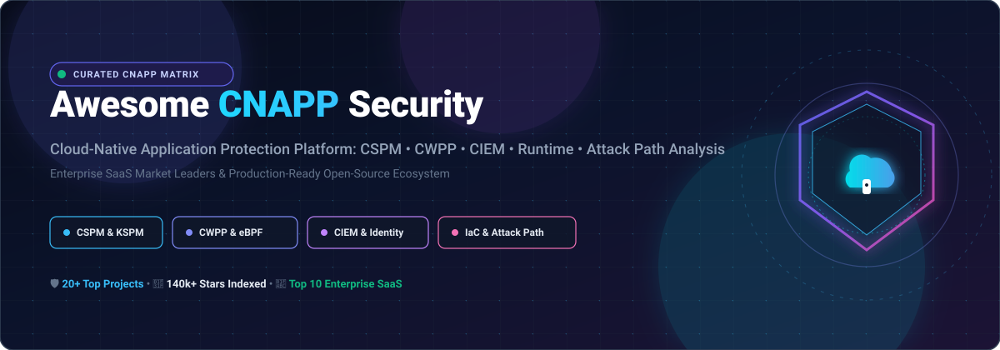

# Awesome-Cloud-Native-Application-Protection-Cnapp

<p align="center">
  
</p>

<p align="center">
  <a href="https://github.com/ishandutta2007/Awesome-Awesome-Awesome"></a>
  <a href="https://discord.gg/jc4xtF58Ve"></a>
  <a href="https://github.com/ishandutta2007/Awesome-Cloud-Native-Application-Protection-Cnapp/stargazers"></a>
  <a href="https://github.com/ishandutta2007/Awesome-Cloud-Native-Application-Protection-Cnapp/network/members"></a>
  <a href="https://github.com/ishandutta2007/Awesome-Cloud-Native-Application-Protection-Cnapp/blob/main/LICENSE"></a>
  <a href="https://github.com/ishandutta2007"></a>
</p>

---

## 🌟 Overview & Key Concepts

**Top Cloud Native Application Protection Platform (CNAPP) Tools & Open-Source Projects 🌟 Star if you like it! 🌟**

A curated list of **Enterprise SaaS Platforms** & **Production-Grade Open-Source GitHub Projects** focused on:
- 🛡️ **CSPM** (Cloud Security Posture Management) & **KSPM** (Kubernetes Security Posture Management)
- ⚙️ **CWPP** (Cloud Workload Protection Platform) & Kernel-level Runtime Observability
- 🔑 **CIEM** (Cloud Infrastructure Entitlement Management) & Identity Risk Analysis
- ⚡ **Runtime Threat Detection** (eBPF, Falco rules, LSM engines)
- 🗺️ **Attack Path Analysis** & Graph-Based Multi-Vector Risk Correlation
- 🔍 **IaC & Shift-Left DevSecOps** (Infrastructure-as-Code scanning, secrets detection, SBOM analysis)

---

## 📑 Table of Contents

- [📊 Sector Overview & Market Dynamics](#-sector-overview--market-dynamics)
- [💼 SaaS/Hosted Platforms](#-saashosted-platforms)
- [🚀 Open-Source GitHub Projects](#-open-source-github-projects)
- [🧩 Composable Open-Source Architecture](#-composable-open-source-architecture)
- [📈 Star History](#-star-history)
- [🤝 How to Contribute](#-how-to-contribute)
- [💖 Support](#-support)
- [⚖️ Disclaimer](#️-disclaimer)

---

## 📊 Sector Overview & Market Dynamics

The global Cloud-Native Application Protection Platform (CNAPP) market was valued at approximately **$8.2B – $10.3B in 2024** and is projected to surpass **$15B by 2026** (scaling past **$30B by 2032**), exhibiting a rapid Compound Annual Growth Rate (CAGR) of **~20% to 22%**.

From a structural standpoint, the CNAPP market is **moderately fragmented yet aggressively consolidating**:
- **Consolidation by Giants**: Established cybersecurity conglomerates (such as Palo Alto Networks, CrowdStrike, and Fortinet) alongside hyperscalers (Microsoft Azure) are driving major acquisitions (e.g., Lacework, PingSafe, Bionic) to deliver unified, consolidated "single-pane-of-glass" platforms.
- **Niche Innovation**: At the same time, the fast evolution of cloud workloads, generative AI infrastructure, and eBPF-based runtime monitoring preserves a vibrant tier of innovative pure-play startups and specialized open-source tools, preventing an absolute "winner-take-all" outcome.

---

## 💼 SaaS/Hosted Platforms

| Platform | Valuation / Company Size | Pricing (Starting Tier) | Free Tier / Trial Limits | Key Capabilities & Best For |
| :--- | :--- | :--- | :--- | :--- |
| **[Microsoft Defender for Cloud](https://azure.microsoft.com/en-us/products/defender-for-cloud)** | ~$3.13T Market Cap ($245B+ revenue) | **$0.0066/server/hr** (~$4.91/server/mo for Plan 1) or **$0.0196/server/hr** (~$14.60/server/mo for Plan 2) | **Free tier available forever** (Foundational CSPM included with Azure: secure score, continuous posture assessments & basic recommendations at no cost); **30-day free trial** per plan for paid Defender for Servers/Containers. | ☁️ Native Azure CNAPP with CSPM, CWPP, and DevSecOps capabilities. Best for Azure-centric and multi-cloud environments wanting native cloud security. |
| **[Palo Alto Prisma Cloud](https://www.paloaltonetworks.com/prisma/cloud)** | ~$119.4B Market Cap ($8.0B+ revenue) | **~$18,000/year** base CSPM (~2 credits/VM); **~$45,000/year** full CNAPP suite (~5 credits/VM) via AWS Marketplace | **No perpetual free tier**; **15 to 30-day free trial** or structured PoC via AWS Marketplace / direct sales. Underlying cloud compute costs apply during trial. | 🛡️ Comprehensive CNAPP covering code security, CSPM, CWPP, and CIEM with credit-based flexible licensing. |
| **[CrowdStrike Falcon Cloud Security](https://www.crowdstrike.com/)** | ~$76.6B Market Cap ($3.9B+ revenue) | **$0.023/host-hour** (EC2/Workspaces runtime), **$0.054/worker node-hour** (K8s containers), **$0.01/Fargate hour** on AWS Marketplace PAYG | **No perpetual free tier**; **15-day free trial** (covers full Falcon Cloud Security platform evaluation; no credit card required, extensions upon request). | 🦅 CNAPP deeply integrated with Falcon platform, uniting runtime protection, CWPP, CSPM, and CIEM with endpoint security. |
| **[Lacework](https://www.lacework.com/)** (Fortinet) | ~$72.4B Market Cap ($5.96B Fortinet revenue; acquired for $152.3M) | **~$22,000 to $26,000/year** starter bundles on AWS Marketplace (unit packages based on ~200 cloud asset blocks) | **No perpetual free tier**; **No self-service free trial** (Evaluation access strictly via guided sales engineer Proof of Concept / PoC evaluation license). | 🧠 Behavioral anomaly detection, automated baseline modeling, and CNAPP capabilities under Fortinet FortiCNAPP suite. |
| **[Wiz](https://www.wiz.io/)** | ~$12B - $32B Valuation ($500M+ ARR) | **$24,000/year** (Wiz Essential tier, min. block of 100 workloads / ~$240/workload/yr) on AWS Marketplace | **No perpetual free tier**; **14-day free trial** (includes initial agentless risk assessment scan and guided PoC). | 🌐 Unified security graph correlating cloud infrastructure, workloads, identities, and code. Category leader for full-stack agentless posture and risk correlation. |
| **[SentinelOne Singularity Cloud](https://www.sentinelone.com/)** | ~$7.1B Market Cap ($800M+ revenue) | **$36/VM or node/month** (~$432/node/yr) for Cloud Workload Security; Endpoint tiers start from **$60/agent/yr** (Core) | **No perpetual free tier**; **14-day free trial** available via AWS Marketplace / direct proof-of-concept evaluation. | ⚡ AI-native CNAPP and CWPP offering high-speed kernel-level behavioral prevention, detection, and autonomous remediation. |
| **[Tenable Cloud Security](https://www.tenable.com/)** | ~$4.7B Market Cap ($850M+ revenue) | **~$15,000 to $18,000/year** enterprise starting baseline for cloud resource exposure modules (metered per billable cloud resource) | **No perpetual free tier**; **No self-serve free trial** (requires vendor sales engagement and guided enterprise PoC). | 🔑 CNAPP with identity-first risk assessment and CIEM depth; maps entitlement graphs and effective permissions across multi-cloud. |
| **[Sysdig Secure](https://sysdig.com/)** | ~$2.5B Valuation ($150M+ ARR) | **$0.13/host-hour** metered rate on AWS Marketplace (or ~$1,500/host/year baseline enterprise commitment packages) | **No perpetual free tier**; **30-day free trial** available on AWS Marketplace and direct SaaS (full CNAPP features enabled; cloud compute costs apply). | 📦 CNAPP with runtime insight built on Falco lineage; container-focused detection, drift control, and posture management. |
| **[Orca Security](https://orca.security/)** | ~$1.8B Valuation ($64M+ ARR) | **$7,000/month** (~$84,000/year) entry starter packs on AWS Marketplace covering baseline concurrent cloud workloads | **No perpetual free tier**; **30-day free trial** / complimentary cloud risk assessment available via AWS Marketplace. | 🐋 Agentless CNAPP with patented SideScanning technology for cloud workload, container, and sensitive data discovery. |
| **[Aqua Security](https://www.aquasec.com/)** | ~$1.0B+ Valuation ($90M+ ARR) | **~$15,000 to $20,000/year** starting enterprise entry tier (metered by workload units, e.g. VMs/nodes/repos) via AWS Marketplace | **No perpetual free tier** (Open-source Trivy scanner is free forever); **14 to 30-day free trial** / proof-of-concept evaluation for the Aqua Enterprise CNAPP platform. | 🌊 Cloud-native application protection covering container image scanning, supply chain pipeline security, K8s runtime, and CSPM. |

---

## 🚀 Open-Source GitHub Projects

*Sorted in descending order by GitHub Stars ⭐. Each star badge links directly to the project's stargazers.*

1. **[Trivy](https://github.com/aquasecurity/trivy)** [](https://github.com/aquasecurity/trivy/stargazers)  
   **Comprehensive All-in-One Scanner** (Apache-2.0) — The most widely adopted multi-purpose scanner for containers, Kubernetes, Infrastructure as Code (IaC), Git repositories, and Software Bill of Materials (SBOM). Features vulnerability scanning (OS & language packages), misconfiguration checks, and automated CI/CD shift-left workflows.

2. **[Prowler](https://github.com/prowler-cloud/prowler)** [](https://github.com/prowler-cloud/prowler/stargazers)  
   **Multi-Cloud Security Posture Management (CSPM)** (Apache-2.0) — The industry-standard open-source CSPM tool performing continuous posture checks across AWS, Azure, GCP, and Kubernetes. Features hundreds of out-of-the-box checks mapped to CIS Benchmarks, NIST CSF, PCI-DSS, HIPAA, SOC 2, and ISO 27001 with attack path mapping.

3. **[Infracost](https://github.com/infracost/infracost)** [](https://github.com/infracost/infracost/stargazers)  
   **Cloud Cost Governance & Shift-Left Visibility** (Apache-2.0) — Infracost provides proactive cloud resource policies and cost visibility directly in pull requests, allowing DevSecOps teams to guard against misconfigured resource provisioning before deployment.

4. **[Open Policy Agent (OPA)](https://github.com/open-policy-agent/opa)** [](https://github.com/open-policy-agent/opa/stargazers)  
   **Unified Policy-as-Code Engine** (Apache-2.0, CNCF Graduated) — Flexible, declarative policy engine powered by Rego. Decouples security and compliance policies from microservices, Kubernetes admission controllers, API gateways, and cloud infrastructure pipelines.

5. **[Kubescape](https://github.com/kubescape/kubescape)** [](https://github.com/kubescape/kubescape/stargazers)  
   **Kubernetes Security Platform** (Apache-2.0, CNCF Incubating) — Complete open-source K8s security tool covering posture, vulnerability management, and runtime visibility. Features misconfiguration scanning (NSA-CISA, CIS), Grype image scanning, Copacetic auto-remediation, and eBPF runtime inspection.

6. **[Falco](https://github.com/falcosecurity/falco)** [](https://github.com/falcosecurity/falco/stargazers)  
   **Cloud-Native Runtime Threat Detection** (Apache-2.0, CNCF Graduated) — The de facto standard runtime security monitor. Utilizes eBPF or kernel probes to capture Linux system calls and match events against an extensive community rule set to alert on container escapes, unauthorized file access, and anomalous processes.

7. **[Checkov](https://github.com/bridgecrewio/checkov)** [](https://github.com/bridgecrewio/checkov/stargazers)  
   **Static Analysis for Infrastructure-as-Code (IaC)** (Apache-2.0) — Scans cloud infrastructure provisioned through Terraform, CloudFormation, Kubernetes, ARM templates, and Serverless framework for security misconfigurations and compliance posture issues.

8. **[Kyverno](https://github.com/kyverno/kyverno)** [](https://github.com/kyverno/kyverno/stargazers)  
   **Kubernetes-Native Policy Management** (Apache-2.0, CNCF Incubating) — Designed specifically for Kubernetes, Kyverno manages policies as standard K8s resources without requiring specialized languages, validating, mutating, generating configurations, and verifying software supply chain signatures.

9. **[kube-bench](https://github.com/aquasecurity/kube-bench)** [](https://github.com/aquasecurity/kube-bench/stargazers)  
   **CIS Kubernetes Benchmark Assessment Tool** (Apache-2.0) — Checks whether Kubernetes nodes, master components, and etcd clusters are deployed according to security best practices specified in the CIS Kubernetes Benchmark.

10. **[Steampipe](https://github.com/turbot/steampipe)** [](https://github.com/turbot/steampipe/stargazers)  
    **SQL-Based Multi-Cloud Posture Query Engine** (AGPL-3.0) — Exposes cloud APIs (AWS, Azure, GCP, Kubernetes) as SQL tables, enabling real-time posture queries, compliance dashboards, and asset inventory audits using standard SQL.

11. **[Deepfence ThreatMapper](https://github.com/deepfence/ThreatMapper)** [](https://github.com/deepfence/ThreatMapper/stargazers)  
    **Full Open-Source CNAPP Platform** (Apache-2.0) — The closest single-project open-source equivalent to commercial CNAPPs. Combines agentless and eBPF sensors to discover workloads, map network topology, scan vulnerabilities/secrets, and correlate graph-based attack paths from entry point to sensitive data.

12. **[Terrascan](https://github.com/tenable/terrascan)** [](https://github.com/tenable/terrascan/stargazers)  
    **Scalable IaC Vulnerability & Compliance Analyzer** (Apache-2.0) — Scans Infrastructure as Code (Terraform, K8s, Dockerfile) with 500+ out-of-the-box policies to detect vulnerabilities and compliance deviations prior to cloud deployment.

13. **[Tetragon](https://github.com/cilium/tetragon)** [](https://github.com/cilium/tetragon/stargazers)  
    **eBPF-Based Security Observability & Real-Time Enforcement** (Apache-2.0) — Delivers in-kernel runtime security enforcement. Unlike pure detection sensors, Tetragon can block execution and terminate malicious processes directly in kernel space before system calls return.

14. **[kube-hunter](https://github.com/aquasecurity/kube-hunter)** [](https://github.com/aquasecurity/kube-hunter/stargazers)  
    **Kubernetes Penetration Testing & Weakness Discovery** (Apache-2.0) — Hunts for security vulnerabilities and misconfigurations in Kubernetes clusters from both an outside (remote scan) and inside (pod-level) attacker perspective.

15. **[Tracee](https://github.com/aquasecurity/tracee)** [](https://github.com/aquasecurity/tracee/stargazers)  
    **eBPF Runtime Security & Behavioral Forensics** (Apache-2.0) — Uses Linux eBPF technology to capture system-level behavioral activity in real time, alerting on anomalous events and malicious patterns using Rego signature engines.

16. **[SecretScanner](https://github.com/deepfence/SecretScanner)** [](https://github.com/deepfence/SecretScanner/stargazers)  
    **Container & File System Secret Detection** (Apache-2.0) — Lightweight, high-performance tool for finding secrets, private keys, passwords, and API credentials in container images and local directory trees.

17. **[KubeArmor](https://github.com/kubearmor/KubeArmor)** [  
    **LSM-Based Zero-Trust Container Runtime Defense** (Apache-2.0, CNCF Sandbox) — Enforces kernel-level runtime restrictions using AppArmor, SELinux, and BPF-LSM to prevent privilege escalation, unauthorized process execution, and sensitive file access.

18. **[kubeaudit](https://github.com/Shopify/kubeaudit)** [](https://github.com/Shopify/kubeaudit/stargazers)  
    **Kubernetes Cluster Configuration Auditor** (MIT) — CLI tool and automated controller from Shopify that audits Kubernetes manifests against security recommendations and auto-generates patched definitions.

19. **[CloudRec](https://github.com/antgroup/CloudRec)** [](https://github.com/antgroup/CloudRec/stargazers)  
    **Multi-Cloud Posture & Asset Management Platform** (Apache-2.0) — Discovers cloud inventory across 30+ services and 200+ resource types (AWS, GCP, Alibaba Cloud) with an OPA-driven declarative rule evaluation engine.

20. **[OWASP OpenShield](https://github.com/OWASP/openshield)** [](https://github.com/OWASP/openshield/stargazers)  
    **Open-Source Multi-Cloud Posture & Remediation** (OWASP Project) — Posture scanner featuring automated remediation playbooks via CLI, quantum-unsafe cryptography checks, and direct Microsoft Sentinel telemetry integration.

---

## 🧩 Composable Open-Source Architecture

Commercial CNAPP platforms bundle CSPM, CWPP, CIEM, and attack path correlation into a single turnkey solution. In open-source, no individual tool satisfies all domains in isolation. Instead, production teams build a **composable CNAPP stack**:

```
 ┌────────────────────────────────────────────────────────────────────────┐
 │                     Shift-Left & DevSecOps Layer                       │
 │        Trivy (Vulnerabilities) • Checkov / Terrascan (IaC) • Infracost │
 └───────────────────────────────────┬────────────────────────────────────┘
                                     ▼
 ┌────────────────────────────────────────────────────────────────────────┐
 │                   Cloud Posture Management (CSPM/KSPM)                 │
 │       Prowler • Steampipe • Kubescape • kube-bench • CloudRec          │
 └───────────────────────────────────┬────────────────────────────────────┘
                                     ▼
 ┌────────────────────────────────────────────────────────────────────────┐
 │                   Policy & Admission Enforcement                       │
 │             Open Policy Agent (OPA) • Kyverno • kubeaudit              │
 └───────────────────────────────────┬────────────────────────────────────┘
                                     ▼
 ┌────────────────────────────────────────────────────────────────────────┐
 │                  Runtime Observability & CWPP (eBPF)                   │
 │           Falco • Tetragon (Enforcement) • Tracee • KubeArmor          │
 └───────────────────────────────────┬────────────────────────────────────┘
                                     ▼
 ┌────────────────────────────────────────────────────────────────────────┐
 │               Unified Threat Mapping & Attack Path Correlation         │
 │                         Deepfence ThreatMapper                         │
 └────────────────────────────────────────────────────────────────────────┘
```

---

## 📈 Star History

[](https://star-history.dera.page/#ishandutta2007/Awesome-Cloud-Native-Application-Protection-Cnapp&type=date&legend=top-left)

---

## 🤝 How to Contribute

Contributions are welcome! Please follow these simple steps:

1. 🍴 Fork this repository.
2. 🌿 Create a descriptive branch: `git checkout -b add-awesome-tool`.
3. 📝 Add or update entries in `README.md` maintaining alphabetical or star-ranked consistency.
4. 🔗 Include project name, official URL, license, GitHub star badge, and an accurate capability summary.
5. 🚀 Submit a Pull Request with a clear description of your changes.

---

## 💖 Support

If you found this curated CNAPP resource helpful, please consider supporting the project:

- 🌟 **Star** the repository to help others discover it
- 🍴 **Fork** and contribute your favorite cloud security tools
- 📢 **Share** with your DevOps, DevSecOps, and platform engineering peers
- ☕ **Buy me a coffee**: Support ongoing curation via the [GitHub Sponsor Dashboard](https://github.com/sponsors/ishandutta2007)

[](https://github.com/sponsors/ishandutta2007)

---

## ⚖️ Disclaimer

- This list is **community-curated** for educational, architectural, and evaluation purposes; it does not constitute an endorsement.
- CNAPP tools interface with sensitive cloud configurations and execution privileges—ensure scanner service principals and agents adhere to the principle of least privilege.
- Pricing metrics, valuations, and marketplace listings fluctuate over time; always confirm latest commercial terms directly with vendor representatives.
